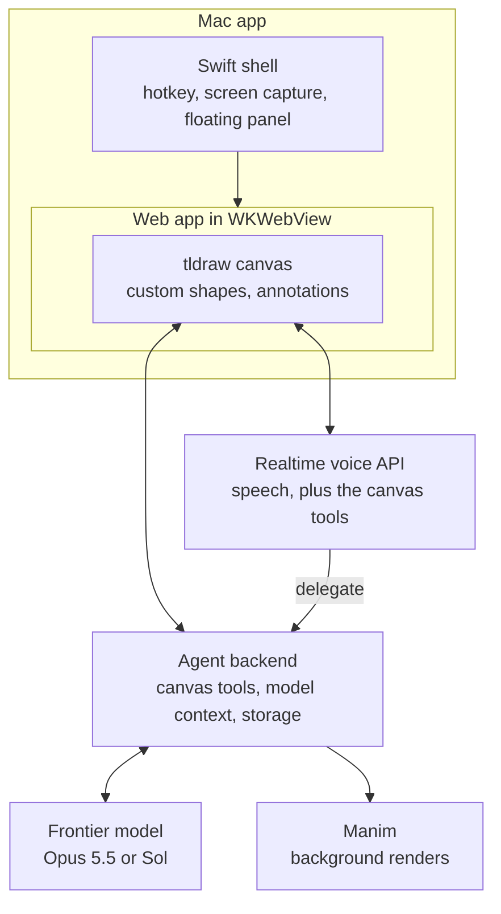

# Easel

Oct 31, 2026 · @Guy-robert

## Product direction

A shared multimodal canvas where people and agents explore, create, and revise ideas together. Learning a technical topic, planning a project, building a mockup, and brainstorming are all uses of the same collaboration model, so the product is not limited to one subject or to tutoring.

The bet is that people prefer working with agents this way over chat. Individual features do not need to be novel. What matters is the quality of continuous collaboration: both participants work on the same objects, and text, voice, ink, and comments all change the same board state.

Two repeatable sessions are the test bed for every change: exploring a physics concept and developing a project mockup.

## Interaction model

The user and the AI work on one infinite canvas. Both act through the same set of primitives, and every action changes shared board state that the other side can see.

| Primitive | User | AI |
| --- | --- | --- |
| Ask | Types or speaks with nothing selected | Asks the user a question, by voice or as a note |
| Annotate | Circles, underlines, or highlights an element, then types or speaks about it | Highlights an element and attaches a note or arrow to it |
| Manipulate | Drags a slider, moves an object, changes a parameter | Sets parameters on graphs and simulations |
| Sketch | Draws a freehand diagram or curve | Turns a sketch into a precise shape |
| Predict | Places a guess before a result is shown | Requests a prediction, then reveals the result next to it |

The AI acts when the user addresses it by voice or text. It may also act after the user pauses: a change on the board starts a debounce of about 1.5 s, any new user interaction cancels the pending check, and changes the agent made itself never start one. When the check runs, staying quiet is a valid outcome.

## Board layout

One board per topic or project. The AI judges the scope and form of each request: one diagram, a step-by-step flow, a sketch, a mockup, or a map. Nothing in code forces a form. When the form is open and the choice changes the work, the AI asks the user one short question with a few choices, then waits for the answer. A focused question gets one focused visual beside related work. When the work has several connected parts, such as a lesson or a project plan, the AI first places a map: a row of empty tldraw frames, one per part, each with a title and a one-line description of what it will hold. For Fourier transforms that might be intuition, the math, a worked example, and applications. For a mockup it might be goals, user flow, screens, and open decisions. The AI then fills the frames one at a time, so the user can start working in the first frame while later ones are still being generated. The user can cancel or retry generation per frame.

The area to the left of the map is the user's space for scratch work, drawings, and their own notes. Protected regions are enforced in code: agent commands that target them are rejected unless the user asked for that change. A shape the user created is protected, and a frame the user draws marks a region: everything inside it is protected too. The user asks for a change to protected work by selecting it, adding it as context, or naming it. Protection stays invisible until the agent bumps into it, when the board outlines the user's work faintly for a moment. New AI content goes next to the frame it relates to, and the user's camera stays where it is while the agent adds content elsewhere.

The user can ask the AI to add a frame, split one into smaller parts, or go deeper on one part. Each of those runs the same skeleton-then-fill process on a smaller scope.

## Architecture

One set of canvas tools serves the UI, the voice model, and the agent.



Components and how they connect.

The Swift shell handles the hotkey and screen capture and hosts the web app. The canvas and the voice model both change the board through the agent backend's canvas tools. The backend calls a frontier model for topic maps and new visualizations, and runs Manim jobs in the background.

## Canvas and shapes

The canvas is the current tldraw SDK (5.6.0 on npm as of November 2) in a React app, starting from the tldraw agent starter kit at the matching version. Reuse the starter's context collection, validated actions, streaming, and cancellation, and extend its shape schemas so the agent can read and edit custom parameters. tldraw is free on localhost. Shipping it, including inside a desktop app, requires a tldraw license key.

Built-in tldraw shapes cover notes, text, arrows, frames, highlights, and freehand strokes. Interactive content uses custom shapes that host React components:

| Shape | Renders with | Parameters both sides can set |
| --- | --- | --- |
| `GraphShape` | Mafs or JSXGraph | Function, domain, marked points, sliders |
| `SimShape` | Three.js with a physics step in code | Simulation type and its parameters, such as launch angle and initial velocity |
| `EquationShape` | KaTeX | LaTeX source, highlighted terms |
| `DiagramShape` | D3 | Nodes, edges, layout |
| `VideoShape` | HTML video | Source file from a Manim render |

Each custom shape stores its parameters in tldraw shape props, so a change from either side is a normal board update and syncs to everything else that reads the board.

Shapes expose stable shape and part IDs, such as `g1.curve` or `eq3.term2`, so annotations, pointing, and agent commands can target parts of a shape.

### Visual direction

The board should feel like paper: warm paper tones, dark ink, an editorial serif for prose, a clean sans-serif for controls, generous spacing, and low surface contrast. Content looks typeset onto the canvas, and frames organize it quietly instead of enclosing everything in cards or sticky notes. Selection outlines and contextual controls appear when needed, and permanent interface chrome stays small. Body text starts around 17 to 18 px at reading zoom. Source Serif 4 is a candidate for the serif, to be compared against reference typography before it is chosen. Text wrapping, selection, equation alignment, and editing get refined before decorative motion. tldraw custom themes and rich text cover most of this.

## Agent and canvas tools

The agent backend is a local TypeScript process that shares shape schemas and the command model with the frontend. Every board change, from the UI or the agent, is a validated command, so there is one code path for every change.

- Each command records its origin: user, agent, or voice.
- Dragging and other direct manipulation apply locally and immediately. The command is recorded after the fact.
- Agent commands carry the board revision they were based on. A command whose target changed since then is rejected as stale.
- Commands into protected user regions are rejected.
- Cancel stops future agent work. Revert is a separate action, and reverting agent work never removes newer human work.

The agent's tools are commands:

| Tool | Effect |
| --- | --- |
| `map(frames, frameWidth, frameHeight)` | Places a row of titled topic-map frames, then the app requests one fill per frame |
| `create_note(text, near)` | Adds a text note next to a shape |
| `draw_arrow(from, to, label)` | Connects two shapes |
| `place_graph(spec, frame)` | Adds a `GraphShape` |
| `place_sim(type, params, frame)` | Adds a `SimShape` |
| `place_equation(latex, frame)` | Adds an `EquationShape` |
| `set_param(shape, key, value)` | Changes a parameter on a graph or simulation |
| `highlight(shape, part)` | Highlights a shape or a named part of it |
| `ask_prediction(shape, prompt)` | Asks the user to place a guess on a shape |
| `reply_in_thread(annotation, text)` | Answers an annotation in place |
| `render_animation(description, frame)` | Starts a background Manim job that adds a `VideoShape` when done |

**Model context.** Each call includes the shapes in and near the current view as JSON (type, props, position, frame), the selected objects, relevant annotation threads, the changes since the last call, and screenshots targeted at regions with freehand strokes or sketches. The JSON covers everything placed on the board and every parameter value.

**Models.** The backend is provider-agnostic: one interface over Claude Opus 5.5, GPT-6.1 Sol, and Gemini 4 Argon, so the same session can be compared across models. A frontier model writes maps and new visualization code.

## Visualization

The agent picks the fastest way that can show something, and loads the instructions for a slower way only when it needs it.

| Approach | Good for | How it is produced |
| --- | --- | --- |
| Native and catalog shapes | Equations, graphs, the projectile simulation, laid-out diagrams, free-body sketches, mockups | The model creates a shape and sets its props. Renders immediately, and the user can edit every part |
| Templates | Common topics, such as a projectile, a pendulum, or a wave | The model instantiates a hand-written scene and sets a few parameters. Renders within about 3 seconds |
| Scenes | New visuals made of geometry, formulas, and motion | The model writes a declarative scene, one object at a time (see below). First object within about 5 seconds, complete within about 15 |
| Generated code | Visuals a scene cannot express: custom interaction, pixel work, 3D, a clickable prototype from a mockup | A background job, like Manim. The model writes a small HTML and JS program that runs in a sandboxed iframe shape behind a placeholder. See "Generated code" below |
| Manim | Polished animations to keep. A low-resolution render and representative frames are reviewed for layout before the final render, and content correctness is checked separately | `render_animation`, in the background |

Vega-Lite charts wait until a session needs real data charts. Mermaid is not used: the native `diagram` action lays out boxes and bound arrows the user can move, which a static Mermaid SVG cannot match.

### Scenes

A scene is one `scene` shape holding declarative data, in the style of Desmos and GeoGebra. Easel defines only the JSON envelope, and renders it with Mafs.

- **Primitives**, about 12:
  - `param`: a named number with a range, step, and unit. It is the same parameter type the graph and simulation use, so board sliders and `set_parameter` work unchanged.
  - `let`: a named derived value.
  - `point`: a position from expressions. A draggable point is an input, like a slider.
  - `segment`, `line`, `vector`, `circle`, `polygon`.
  - `plot`: y = f(x), parametric curves, and inequality regions.
  - `trace`: the path of a point over time.
  - `label` and `readout`: text, LaTeX, or a computed number, anchored to an object.
- **Fields on every object:** an `id`, which doubles as the part ID for pointing (`s1.velocity`), plus `visible`, `reveal` for predict, and an ink index. Scenes keep the paper look.
- **Time:** two deterministic modes.
  - Closed form, the default: objects use `t`, and playback scrubs it.
  - Stepped: a state block with step rules over `dt`, a fixed-step RK4 integrator, and stop and bounce events, for pendulums, damping, and orbits.

  Playback is local to each viewer. An optional shared pinned time lets the agent stop both views on the moment it explains.
- **Streaming:** the agent creates the scene, then adds or updates one object per action. Objects land one at a time, and each is its own command.
- **Data layout:** `params` and `objects` are stored as maps keyed by name and id, so a user's slider drag and an agent's edit to another object do not conflict. Stale checks and revert work at the level of the changed field for interactive shapes. A slider drag never makes an agent edit to another part of the scene stale, and reverting the agent's edit keeps the user's values.

### Correct, not only pretty

A screenshot catches layout problems, not wrong physics. So:

- Numbers come from the evaluator, never from the model's prose. The agent reads a scene as computed values, and quotes them.
- Each scene carries checks the agent writes, such as `range == v0^2*sin(2*theta)/g` or "energy drift under 1 percent". Failures come back to the agent in its next pass.
- Automatic lints catch values that break at a parameter's minimum, middle, or maximum, objects outside the view, zero-length vectors, and degree and radian or unit mixups.
- A "show formulas" toggle lets the learner see what is drawn.
- Templates keep their checks, with a note of the session each was verified on.

### Generated code

Generated code is a background job with a placeholder. Its minimum safeguards are:

- An opaque-origin sandbox: `allow-scripts` without `allow-same-origin`, no network, a strict CSP, and libraries vendored locally.
- Every message from the frame is checked against a schema, with size and rate caps.
- A loop guard. `WKWebView` may not isolate iframes in their own process, so one infinite loop could freeze the board.
- A `snapshot()` call, because the agent's screenshot cannot see inside the frame.

The widget owns no durable state. It declares its params and state, receives them as props, and asks the host for changes. The host applies each change as an ordinary command.

A browser lets a sandboxed frame navigate itself, and no CSP directive stops that. The host stops a frame that loads a second page, but by then one request has left. The Mac shell closes this gap by refusing every frame navigation in its navigation delegate.

### Agent actions and context

The model returns one JSON object of actions. It does not use native tool calls, so provider tool search does not apply. Context stays small this way:

- Unused actions are removed. Every remaining action keeps a one-line entry in the prompt, and the visual actions are always loaded, because they are the product.
- Long manuals, such as the scene language and the generated-code bridge, load on demand in groups. They are appended after the stable, cached part of the prompt, never edited into it, so prompt caching holds. A loaded group stays loaded for the conversation.
- Groups load up front from signals the client already has: a scene in view or selected, a frame the plan tagged as a scene, or a request to simulate or animate. A `load_tools` action is the fallback, and costs one extra model pass.
- The response schema keeps every action name, so OpenAI's and Meta's strict schemas do not change between requests.

Pointing while talking comes from Clicky. Clicky's model appends a tag like `[POINT:x,y:label:screen2]` to its reply. The app strips the tag with a regex, sends the rest to text-to-speech, and flies a cursor in a transparent overlay to the coordinates along a curved path. Clicky needs pixel coordinates because it points at arbitrary apps. On the canvas every target has a shape or part ID, so tags reference those directly, for example `[HL:g1.curve]`. The first version points at the phrase level: a tag fires when its sentence starts playing. Word-level timing needs audio alignment, such as text-to-speech that streams character timestamps. The AI has its own visible cursor on the board that moves between targets.

## Annotations

An annotation is a mark plus a question. It is built in three steps: select and type, then mark and type, then mark and speak. Marks are made with the annotate tool, so ordinary drawing never starts listening or triggers the agent. Once mark and speak is in, listening starts as soon as an annotate stroke ends, so marking and speaking feel like one motion. The app shows which object it thinks the mark targets, and the user can correct it.

When a mark ends, the app takes the stroke's bounding box, finds the shapes it covers, and crops a screenshot of that region. The agent receives one object:

```json
{
  "annotation_id": "a_42",
  "stroke_type": "circle",
  "target_shape_ids": ["g1"],
  "target_detail": "GraphShape g1, y = x^2, near x = 2",
  "region_image": "<png>",
  "text": "why is the slope 4 here?"
}
```

The stroke binds to its target shapes with tldraw bindings, so moving or resizing a graph moves the circle and the AI's reply with it. If the target is deleted, the thread stays on the board, marked as detached. Each annotation is a thread: follow-up questions attach to it, and `reply_in_thread` answers there.

Stroke type sets the default intent when the user gives no text. A circle means explain this, an underline means go deeper, and a strike-through means the user thinks this is wrong. Any text or speech overrides the default.

## Voice

Voice comes in three steps: push-to-talk, then mark and speak, then hands-free conversation. It uses a realtime speech-to-speech API with tool calling over WebRTC in the browser. The voice model gets the same canvas tools as the agent, so it can talk while it highlights, sets parameters, or asks for a prediction. Work that needs a frontier model, such as building a map or writing a new visualization, goes through a `delegate` tool that calls the agent backend and returns when the shapes are on the board. When the user interrupts, speech stops and pending actions that are now obsolete are canceled.

The AI speaks and writes at the same time: short spoken explanations, with the durable content placed on the board as notes and shapes. A transcript of each exchange is stored with the board.

## macOS shell

The canvas stays a web app. The Mac app is a Swift shell that loads it in a `WKWebView` and adds what needs native APIs.

| Feature | Implementation | Permission |
| --- | --- | --- |
| Global hotkey (double tap of a modifier) | `CGEvent.tapCreate` on `flagsChanged`, about a 0.5 s window | Accessibility |
| Floating board window | Non-activating `NSPanel` | None |
| Screen capture mode | ScreenCaptureKit | Screen Recording |
| On-screen selection overlay | Transparent `NSPanel` over the active display | None |
| Microphone | `AVAudioEngine`, or `getUserMedia` inside the web view | Microphone |

The hotkey is configurable and defaults to double Right Option. Double Fn or Globe is the macOS default dictation shortcut, and double Control is one of the dictation alternatives.

**Screen capture mode.** The user presses the hotkey while reading anything on screen, such as a PDF or a lecture slide, and circles a region. The crop lands on the current board as an image shape with the user's question attached as an annotation.

**Bridge.** The web app sends messages to Swift through `WKScriptMessageHandler`. Swift calls into the web app with `evaluateJavaScript`. Messages are JSON with a `type` field, such as `capture_ready` or `open_board`.

The open-source Clicky code (MIT) is a reference for the hotkey, capture, and overlay.

## Storage

Everything is local, in one SQLite database. The database is the SQLite storage of a Durable Object in the agent backend, `BoardDurableObject`. The backend already runs as a Worker with Durable Objects, and in local development their storage is a file in `.wrangler/state`, so a separate database process is not needed.

| Table | Key fields |
| --- | --- |
| `commands` | `command_id, board_id, origin, type, payload, base_rev, status, created_at`, plus `seq` for log order, `rev`, and the other command fields as JSON in `details` |
| `boards` | `board_id`, `title`, `created_at`, `updated_at` |
| `snapshots` | `board_id`, `rev`, `tldraw_snapshot`, `saved_at` |
| `annotations` | `annotation_id`, `board_id`, `stroke_type`, `target_shape_ids`, `text`, `created_at` |
| `thread_messages` | `annotation_id`, `author`, `text`, `created_at` |
| `transcripts` | `board_id`, `speaker`, `text`, `ts` |
| `renders` | `render_id`, `board_id`, `status`, `video_path`, `manim_source` |

Commands persist incrementally as they happen, and a full tldraw snapshot is saved periodically: every 25 commands, or 2 minutes after the last snapshot, and never while an agent is mid-pass, because its previews are not commands. A board loads as its latest snapshot plus the commands after it, and the whole log comes back with it. The command log is the source for undo, revert, and replay. Manim output files live in the app's support directory, referenced by path.

## Build phases

Development starts as a web app on localhost in the browser. Phase 0 tests the product bet with a rough version before the foundation gets polished. Each later phase has a gate that must pass before the next starts.

The phases keep their numbers, but after Phase 4 they are built in this order, so the agent gets good at visuals first:

1. Phase 6, interactive objects.
2. Phase 11, declarative and generated visuals.
3. Phase 12, Manim and `VideoShape`.
4. Phase 9, voice and pointing.
5. Phase 5, sketching and handwriting.
6. Then phases 7, 8, and 10, followed by 13 and 14.

0. **Rough loop, about two weeks.** tldraw agent starter, a simple command model, Ask with skeleton-then-fill, and select-and-type annotations. No styling work.\
**Gate:** run both test sessions and decide whether working this way beats chat.
1. **Paper canvas and typography.** Theme, rich text, frames, arrows, contextual controls, refined on a populated board.\
**Gate:** reading, selecting, editing, and navigating feel coherent with no AI involved.
2. **Commands, undo, and persistence.** Harden the command model: origin, stale-edit rejection, protected regions, cancel and revert, incremental persistence with periodic snapshots.\
**Gate:** reverting agent work never removes newer human work.
3. **Ask and progressive layout.** The agent asks the user when the form of an answer is open. New work lands beside related work, and the user's camera stays still. The user can redo, expand, or stop any one part of the agent's work. Large asks finish across passes instead of hitting the output limit. Asks come by text, with drawings and selections as context; voice arrives in Phase 9.\
**Gate:** on both sessions, an open request gets a question, and the user can redo or stop one part of the agent's work without changing anything else.
4. **Annotations and threads.** Select and type, then mark and type, then mark and speak. Inferred target shown and correctable. Bindings across move, resize, and delete.\
**Gate:** ordinary drawing never starts listening or triggers the agent.
5. **Sketching and handwriting.** Raw ink first, then explicit refine actions, with the original sketch recoverable. Test Apple Pencil, finger panning, and trackpad drawing here.\
**Gate:** switching between drawing, selecting, and editing never fights modes.
6. **Interactive objects.** KaTeX equations and native editable diagrams, then Mafs graphs, then one deterministic 2D simulation. D3 for layout, Three.js when content needs 3D.\
**Gate:** either participant changes a parameter and both see the same result.
7. **Predict and compare.** Predictions, sketches, and alternatives stored as board objects. Results appear next to the originals.\
**Gate:** the board preserves how an idea changed.
8. **Learning mode.** Opt-in, for people who want to learn. Ordinary collaboration is unchanged. The agent shows a minimal worked example, asks the learner to predict or try the next step on the board before revealing it, and keeps a learner profile built from board evidence: predictions, questions, selections, and corrections. A per-topic concept graph the agent drafts and refines from that evidence sets the pace, and weak concepts come back for spaced review across sessions.\
**Gate:** a returning learner's next session starts from what they found hard, and the agent holds back until they have tried.
9. **Voice and pointing.** Push-to-talk, mark and speak, hands-free. Phrase-level pointing by shape and part ID.\
**Gate:** interrupting stops speech and obsolete actions.
10. **Context and proactive behavior.** Debounced checks, canceled on new interaction, ignoring agent-originated changes.\
**Gate:** no self-triggering loops and no interruptions during active work.
11. **Declarative and generated visuals.** In order, each step with its own check:
    1. Agent context: a selection eval of about 40 prompts from the two sessions, token and cache metrics, removed actions, the system prompt split into cache blocks, then on-demand manuals with signal preloading. Check: selection accuracy at or above the baseline, prompt tokens down, and no extra model pass in at least 90 percent of requests.
    2. Scenes: expression parser v2 (multi-argument functions and conditionals), the `scene` shape with params, draggable points, the static primitives and closed-form time, computed descriptions, and field-level stale checks and revert. Check: the agent builds a projectile, a free-body diagram, and a wave, with the first object within 5 seconds and the scene within 15. A slider drag during an agent edit is not rejected, and revert keeps the user's values.
    3. Streaming and correctness: one action per object, agent-written checks, and automatic lints. Check: of 10 seeded wrong scenes, at least 8 are caught and repaired within one pass.
    4. Stepped time. Check: a large-angle pendulum, a damped oscillator, and an orbit, with energy drift under 1 percent over 10 periods, and identical frames for both participants.
    5. About 10 hand-written templates, and saving any scene as one. Check: a template renders within 3 seconds, and the agent prefers a fitting template to a fresh scene.
    6. Generated code as a background job, only when a session needs it. Check: no network, no access to the parent page, an infinite loop does not freeze the board, state goes through commands and revert, and the agent sees the snapshot.\
**Gate:** on both sessions, the agent shows a new concept as a live scene within 15 seconds, both participants change it, and its numbers pass their checks.
12. **Manim and `VideoShape`.** Background rendering with progress, cancellation, cached outputs, and isolated jobs.
13. **Mac shell and screen capture.** `WKWebView` wrapper, hotkey, floating window, ScreenCaptureKit, with captures feeding the annotation flow.\
**Gate:** focus, multiple displays, and permissions work without a second interaction system.
14. **Cross-device.** iPad reconnect, shared-board updates, touch controls. Trusted HTTPS for microphone access on the local network.\
**Gate:** reconnecting never loses ink, annotations, or parameter changes.

The first complete milestone comes after Phase 9 in the build order above. At that point people and agents can write, draw, annotate, manipulate, speak, and point together, and the agent can explain with live objects, charts, diagrams, and animation. The combined experience gets refined before the remaining phases add more systems.

Each change is tested on the two fixed sessions, one interaction at a time, comparing the old and new versions. Tracked: wrong targets, lost or overwritten edits, response latency, unnecessary interruptions, and which version is preferred.

## Open questions

- [ ] Realtime voice provider: OpenAI Realtime, Gemini Live, or a pipeline with character-timestamped text-to-speech?
- [ ] Which jobs, if any, move to a local model through MLX?
- [ ] Should boards link to each other when topics overlap?
